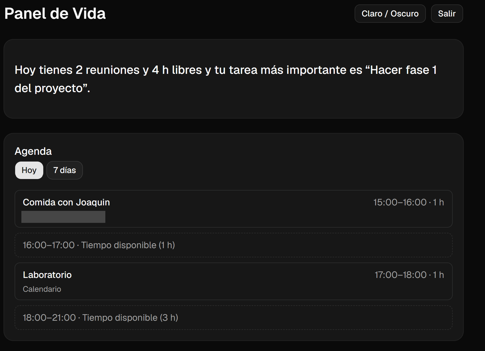
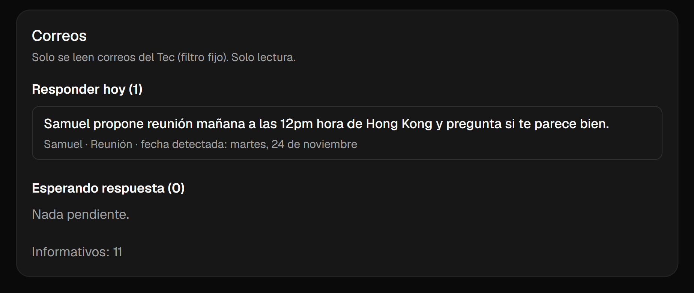
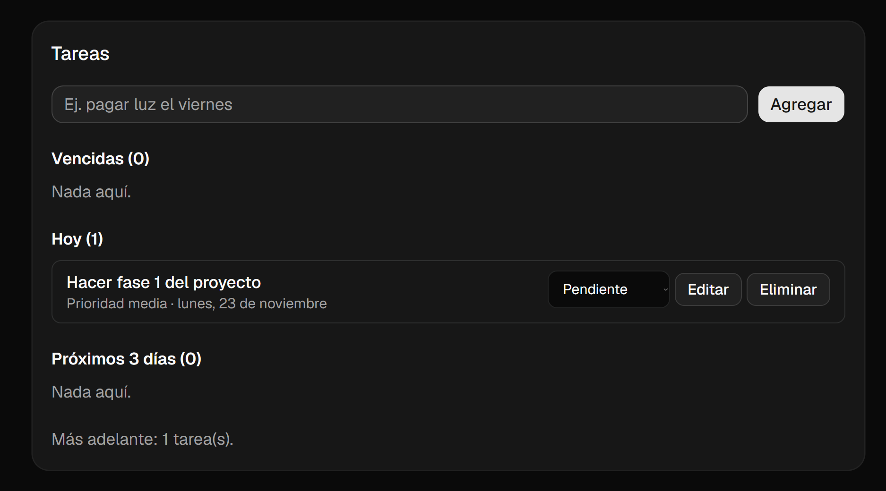
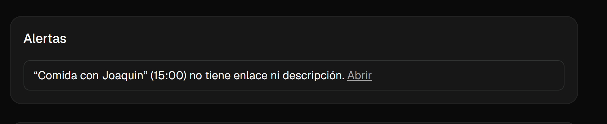
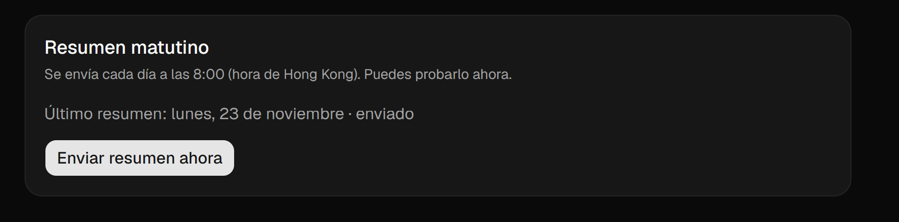

# Panel de Vida ("Life Dashboard")

**Language:** English · [Español](README.es.md)

A personal, **single-user** web app: one page that pulls together my Google Calendar, my university email (filtered), my tasks, and a morning summary sent to my inbox every day.

- **Read-only by design:** the app never sends, deletes or modifies emails or calendar events.
- **Stack:** Next.js (App Router) + TypeScript, Tailwind CSS + shadcn/ui, Supabase (Postgres, Auth, Row Level Security), Google Calendar and Gmail APIs, Anthropic API, Resend, Vercel Cron.
- The UI is in Spanish.

## Features

| Section | What it does |
|---|---|
| Today in one line | Meetings, free hours and your most important task, in a single sentence |
| Agenda | Vertical timeline for today or the next 7 days. Highlights overlaps, gaps under 15 min, and free blocks over 45 min. Reads **every** calendar in `calendarList`, including subscribed ones |
| Email | Recent threads **restricted by a mandatory Gmail query filter**, classified by Claude (reply today / waiting for reply / informational) and cached so threads are not classified twice |
| Tasks | Full CRUD, plus one-line capture in natural language ("pay electricity on Friday") parsed by Claude |
| Alerts | Cross-source checks: emails mentioning a date that is not on the calendar, meetings without link or description, tasks due today without enough free time, days with more than 6 h of meetings |
| Morning brief | A daily cron job generates a short summary with Claude and emails it via Resend. A button lets you trigger it manually |

## Screenshots

Dark theme (the app also has a light theme and a toggle). Personal data is masked.







## Architecture

```
Browser ── Next.js (Vercel) ──┬─ Supabase Auth (Google sign-in, single allowed email)
                              ├─ Supabase Postgres (RLS on every table)
                              ├─ Google Calendar + Gmail APIs (read-only, OAuth)
                              ├─ Anthropic API (classification, task parsing, brief)
                              └─ Resend (brief delivery)
Vercel Cron ── /api/cron/daily-brief (protected by CRON_SECRET)
```

## Security notes

- Google scopes are **read-only** (`calendar.readonly`, `gmail.readonly`).
- The Google refresh token is stored **encrypted** (AES-256-GCM) in `integrations`, protected by RLS.
- Every table has **Row Level Security**: a row is only visible to its owner (`user_id = auth.uid()`).
- Gmail is always queried with `GMAIL_QUERY_FILTER` in the `q` parameter, and nothing is read if the variable is missing. Google's `gmail.readonly` scope cannot be restricted by sender or label, so this limit is enforced in code.
- `/api/cron/daily-brief` validates `CRON_SECRET` on every run (constant-time comparison).
- No keys in the code: everything lives in environment variables. Only `.env.example` (empty placeholders) is committed.
- Email contents are treated as untrusted data in every prompt (prompt-injection hardening), and HTML in the brief email is escaped.

## Local setup

Requirements: Node 20+, npm, Git.

```bash
npm install
cp .env.example .env.local   # then fill in the values (see table)
npm run dev
```

Open http://localhost:3000.

## Environment variables

| Variable | Description |
|---|---|
| `NEXT_PUBLIC_SUPABASE_URL` | Supabase project URL |
| `NEXT_PUBLIC_SUPABASE_ANON_KEY` | Supabase anon/publishable key |
| `SUPABASE_SERVICE_ROLE_KEY` | Supabase service_role/secret key (**server only**, used by the cron job) |
| `ALLOWED_EMAIL` | The only email allowed to sign in |
| `APP_TIMEZONE` | IANA time zone, e.g. `Asia/Hong_Kong` |
| `GOOGLE_CLIENT_ID` / `GOOGLE_CLIENT_SECRET` | Google Cloud OAuth credentials |
| `GOOGLE_REDIRECT_URI` | `https://YOUR-DOMAIN/api/google/callback` (locally: `http://localhost:3000/api/google/callback`) |
| `ENCRYPTION_KEY` | 32 random bytes, base64. Generate with `node -e "console.log(require('crypto').randomBytes(32).toString('base64'))"` |
| `GMAIL_QUERY_FILTER` | Mandatory Gmail filter, e.g. `(from:tec.mx OR to:you@tec.mx OR label:Tec)` |
| `PRIORITY_SENDERS` | (Optional) comma-separated priority senders |
| `TEC_ICS_URL` | (Optional) URL of an `.ics` calendar subscription, read directly instead of waiting for Google to sync it (Google can take 12–24 h or more to refresh subscribed calendars). **Treat it as a secret**: anyone with the URL can read the calendar |
| `TEC_CALENDAR_NAME` | (Optional) Name, in Google Calendar, of the calendar that `TEC_ICS_URL` replaces. It is skipped only when the direct read succeeds, so events never appear twice |
| `ANTHROPIC_API_KEY` | Anthropic API key |
| `ANTHROPIC_MODEL` | Model name (default `claude-sonnet-5-5`) |
| `RESEND_API_KEY` | Resend API key |
| `BRIEF_TO_EMAIL` | Address that receives the brief |
| `BRIEF_FROM` | (Optional) sender; defaults to `Panel de Vida <onboarding@resend.dev>` |
| `CRON_SECRET` | Long random secret protecting the cron endpoint |

## Supabase setup

1. Create a project at https://supabase.com.
2. In the **SQL Editor**, run the files in `supabase/migrations/` in order:
   1. `20261123000000_init.sql` (tables and RLS)
   2. `20261123000100_grants.sql` (privileges for the `authenticated` role)
3. **Authentication → Sign In / Providers → Google:** enable it with your Google Client ID and Secret.
4. **Authentication → URL Configuration:** set the production *Site URL* and add `https://YOUR-DOMAIN/**` and `http://localhost:3000/**` to *Redirect URLs*.

## Google Cloud setup

1. Create a project and enable the **Google Calendar API** and **Gmail API**.
2. **Google Auth Platform → Audience:** user type **External**, publishing status **Testing**, and add yourself as a **test user**.
3. **Data Access:** add the scopes `calendar.readonly` and `gmail.readonly`.
4. **Clients → Create client → Web application.**
   - Authorized JavaScript origins: `http://localhost:3000` and your Vercel domain.
   - Authorized redirect URIs:
     - `https://YOUR-PROJECT.supabase.co/auth/v1/callback`
     - `http://localhost:3000/api/google/callback`
     - `https://YOUR-DOMAIN/api/google/callback`

### Why the Google app stays in "Testing" mode

`gmail.readonly` is a **restricted scope**. Publishing an app that uses it to the general public requires Google's **verification** (an app review and, typically, a paid third-party security assessment). Since this is a personal, single-user tool, that process makes no sense: in *Testing* mode it works for the test users you add.

**Consequence:** in Testing mode Google's refresh token **expires after 7 days**. When that happens, the *Connections* card shows "Not connected" and the morning brief tells you so. Just click **Reconnect**.

## Deploying to Vercel

1. Push the repository to GitHub.
2. In https://vercel.com → **Add New → Project**, import the repository.
3. Add every variable from the table under **Environment Variables** (use your real domain in `GOOGLE_REDIRECT_URI`).
4. **Deploy**, then add the production domain to Google Cloud and Supabase (see above) and redeploy.

### Morning brief schedule

`vercel.json` schedules `0 0 * * *` (UTC), which is **8:00 AM in Hong Kong** (UTC+8, no daylight saving). If you change time zone, convert the hour to UTC and edit that value.

Vercel automatically sends `Authorization: Bearer <CRON_SECRET>` to cron invocations when `CRON_SECRET` is set. On the Hobby plan the job may run at any point within the scheduled hour, not at the exact minute.

To test it by hand, use the **Enviar resumen ahora** (Send brief now) button on the page.

## Scripts

```bash
npm run dev       # development server
npm run build     # production build
npx tsc --noEmit  # type check
npx eslint src    # lint
```

## License

[MIT](LICENSE)
